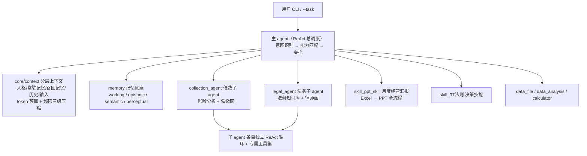

# PropertyMind —— 物业项目智能助手

一个多 agent 编排框架落地到**物业管理场景**的完整实现：ReAct 主调度 agent + 催费/法务子 agent + 技能系统，
内置分层上下文管理（token 预算 + 自动压缩）与自动记忆机制。小模型（qwen3.5:2b / deepseek）也能稳定跑，
靠的是装配层确定性网关，而不是祈祷模型传对参数。

## 架构



## 功能亮点

**1. 上下文工程（`core/context/`）** —— 不是平铺拼接，是有预算的分层组装

- 六层上下文：人格 → 常驻记忆 → 环境 → 召回记忆 → 历史对话 → 本轮输入
- token 预算核算（CJK 1:1 / ASCII 4:1 粗估），`/context` 随时检视各层占用
- 超限三级压缩：旧工具结果截断 → 旧对话折摘要 → 成组丢弃（严格保持
  `tool_calls`/`tool` 消息配对合法，不会打出 HTTP 400）

**2. 记忆是框架机制，不是模型调用的工具**

- 常驻记忆：项目 `MEMORY.md` 启动即注入（对标 CLAUDE.md）
- 召回记忆：每轮按输入检索相关事实（中文 bigram 相似度，零分词依赖）
- 轮末自动沉淀：对话中出现的偏好/背景/修正要求，LLM 提取后**落盘** MEMORY.md，重启仍在
- `#内容` 快捷写入，`/memory` 检视记忆状态

**3. 流式输出 + 并行子 agent**

- 最终回复逐字流式打到终端
- 模型一次发多个 tool_calls 时并行执行（催费+法务同时跑），结果按 id 确定性配对

**4. 小模型适配工程（本仓库踩坑最多也最值钱的部分）**

- 装配层确定性网关：如 PPT 技能固定主数据源、法务工具强制 namespace——
  模型臆造参数也打不穿（见 `main.py:PropertyPptSkill`）
- 全链路 `reasoning_content` 兜底：思考型模型正文为空也能拿到回答
- 所有可选依赖（Qdrant/Neo4j/embedding）懒构造 + 失败自禁用，**辅助功能不可用绝不崩主流程**

## 快速上手

```bash
git clone <repo-url> && cd PythonProject7
python -m venv .venv
.venv\Scripts\activate          # Windows；Linux/Mac: source .venv/bin/activate
pip install -r requirements.txt

copy .env.example .env          # 填入 DEEPSEEK_API_KEY（或其他 provider 的 key）
python main.py
```

> 最小可跑配置只需一个 `DEEPSEEK_API_KEY`。Qdrant/Neo4j/embedding 不配也能跑，
> 相关功能自动降级（有 warning，无异常）。

数据文件在 `data/common/`（物业房产客户/应收/缴费/欠费/收缴率五张表），
PPT 汇报技能会自动取数生成 `skill_outputs/` 下的完整经营分析 PPT。

## 交互命令

| 输入                           | 作用                                 |
| ------------------------------ | ------------------------------------ |
| `--task "项目经理月度汇报"`  | 一次性任务模式，执行完退出           |
| `/context`                   | 各层 token 占用（对标 /context）     |
| `/compact`                   | 全部历史收拢为一条摘要               |
| `/clear`                     | 清空会话历史                         |
| `/memory`                    | 常驻记忆文件 + 召回库状态            |
| `#内容`                      | 直接写一条长期记忆（落盘 MEMORY.md） |
| `exit` / `quit` / `退出` | 结束会话                             |

## 目录结构

```
main.py                    入口：装配能力表、起 CLI
agents/react_agent/        ReAct 主 agent（意图识别→规划→ReAct 循环→记忆沉淀）
agents/sub_agent_tool.py    子 agent 装配（技能包文档 → 独立人格 + 专属工具）
core/context/              分层上下文：budget / provider / compactor / manager
core/capability.py          技能与工具的统一能力路由（Capability 协议）
memory/                     四类记忆存储（working/episodic/semantic/perceptual）
skills/                     SKILL.md 技能包（ppt_skill / 37法则 / 催费 / 法务）
tool/                       工具集（数据问答 / 账龄分析 / 催缴函 / RAG / deck 全家桶）
scripts/                    验证与实验脚本（见下）
data/common/                物业业务数据（Excel）
```

## 验证与实验脚本

```bash
# 上下文模块：预算核算 / 记忆注入 / 降级 / 压缩（纯逻辑，不需要 LLM）
python scripts/verify_context.py

# 记忆链路：中文写入→召回→Provider 全链
python scripts/verify_memory.py

# 召回实验台：自己出题，实时看召回了什么、注入文本长什么样
python scripts/experiment_recall.py --demo
```

## License

MIT
